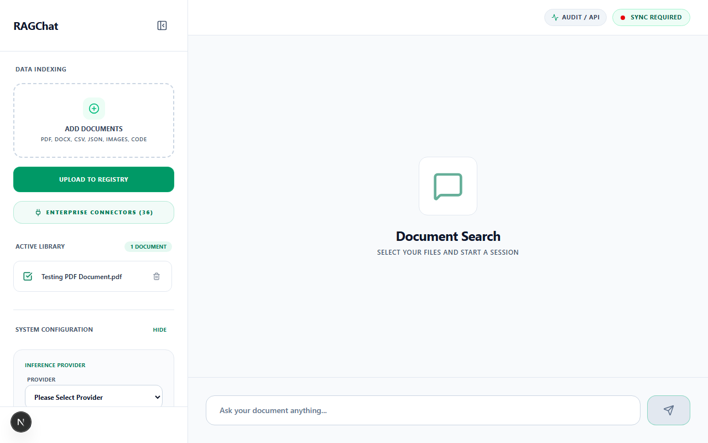
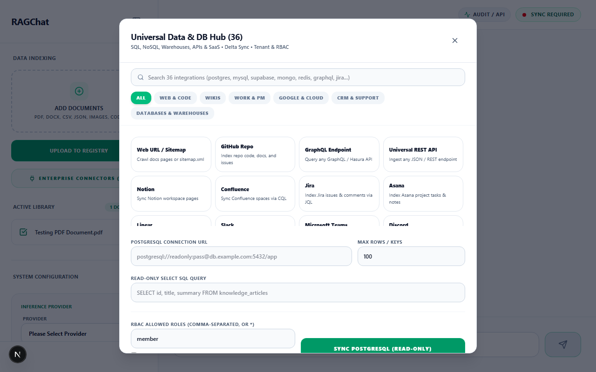
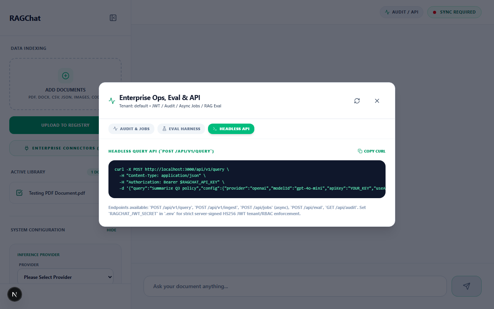
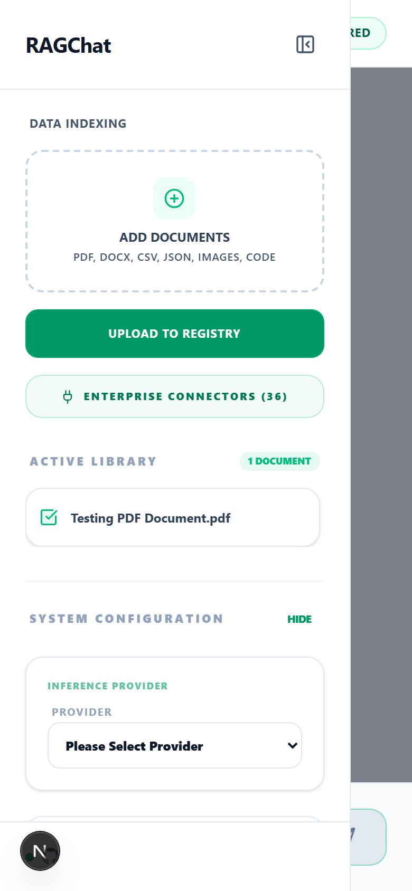
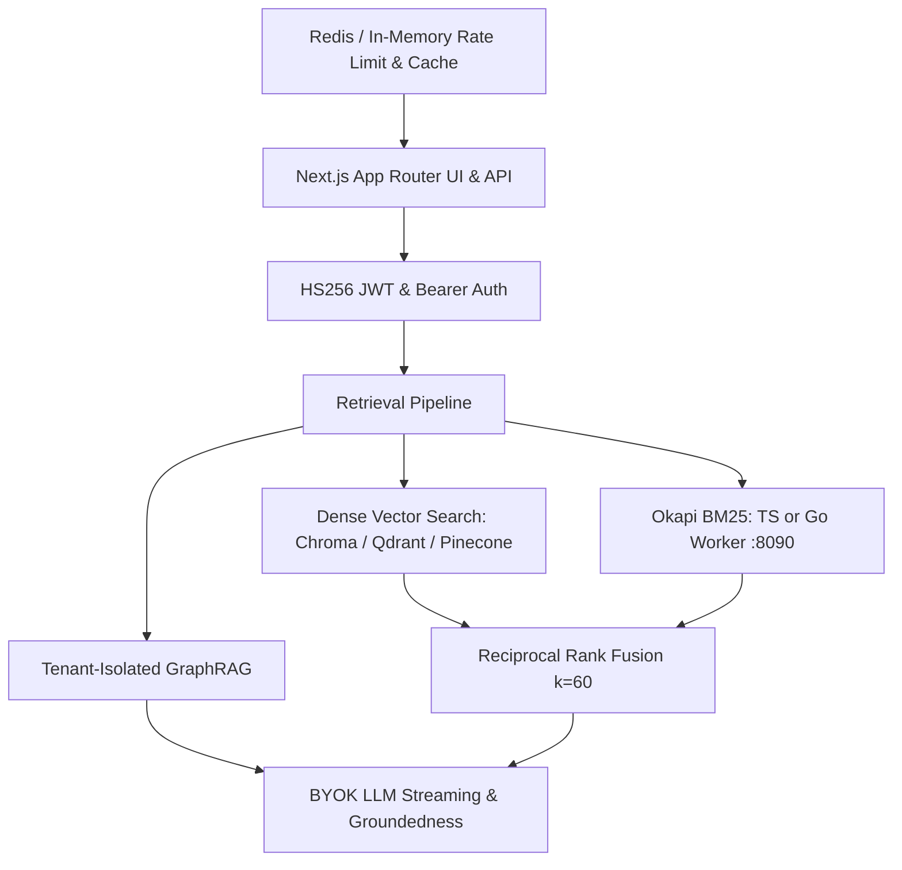

# RAGChat

A multi-tenant Retrieval-Augmented Generation (RAG) web application and API built with Next.js 15, TypeScript, pluggable vector stores, 36 data connectors, and an optional Go processing sidecar.

## Overview

RAGChat indexes files, wikis, ticketing systems, cloud buckets, and read-only SQL/NoSQL databases into isolated tenant namespaces, then answers questions using Hybrid Search (dense vectors + Okapi BM25 + Reciprocal Rank Fusion), optional cross-encoder reranking, and optional GraphRAG entity-relation traversal with inline bracketed citations.

You supply LLM and database credentials directly in the browser UI (held in React memory without database persistence) or configure server environment variables for automated pipelines and headless API callers.

## Live Demo and Screenshots


Watch the full resolution recording: [demo.mp4](docs/media/demo.mp4)

| View | Screenshot |
|------|------------|
| Desktop Workspace (`1280x800`) |  |
| 36-Connector Hub |  |
| Enterprise Ops, Eval & API |  |
| Mobile Responsive (`390x844`) |  |

## Architecture



## Core Capabilities

- **Document & Multimodal Indexing**: Parses `.pdf`, `.docx`, `.txt`, `.md`, `.ts`, `.js`, `.py`, `.css`, `.html`, `.csv`, `.json`, and extracts text/tables from `.png`, `.jpg`, `.jpeg`, and `.webp` images via vision models. Tracks SHA-256 content hashes to skip unchanged files and replace stale chunks.
- **36 Data & Database Connectors**: Syncs data from web URLs/sitemaps, GitHub, Notion, Confluence, Jira, Asana, Linear, Slack, Microsoft Teams, Discord, Amazon S3/MinIO, Google Drive, SharePoint/OneDrive, Gmail, Google Sheets, BigQuery, GCS, Salesforce, Zendesk, HubSpot, Airtable, PostgreSQL, MySQL/MariaDB, ClickHouse, Databricks, Turso, Snowflake, MongoDB, Supabase, Elasticsearch, Firestore, DynamoDB, Redis (`SCAN`), GraphQL, and generic REST JSON APIs.
- **Pluggable Vector Stores**: Switches between ChromaDB, Qdrant, and Pinecone with tenant namespace scoping and per-document RBAC role filtering (`allowedRoles`).
- **Hybrid, Agentic & GraphRAG Retrieval**: Combines conversational query rewriting, query decomposition with second-hop corrective retrieval, dense similarity + BM25 + RRF, Cohere/Voyage/custom reranking, full-context CAG mode, and entity-relation traversal.
- **Governance & Evaluation**: Redacts emails, phone numbers, SSNs, payment cards, and API keys when enabled; logs structured events to memory or JSONL (`AUDIT_LOG_FILE`); measures `Recall@K`, `MRR`, groundedness, and latency in `/api/eval`.
- **Polyglot Go Sidecar (`services/worker`)**: Offloads concurrent SHA-256 hashing, PII masking, contextual chunking, and Okapi BM25 scoring to a Go HTTP service when `WORKER_URL` is configured, falling back to TypeScript automatically when absent.

## Quick Start with Docker Compose

Run Next.js, the Go worker, Qdrant, and Redis in one stack:

```bash
cp .env.example .env
docker compose up --build
```

Open `http://localhost:3000`. The app connects to Qdrant (`http://qdrant:6333`), Redis (`redis://redis:6379`), and the Go worker (`http://worker:8090`) automatically inside the Compose network.

## Local Development

**Prerequisites**: Node.js 22+, `uv` or Python 3.11 (for local ChromaDB `0.6.3`), and Go 1.22+ (optional, for the sidecar worker).

1. Install Node dependencies:

```bash
npm install --legacy-peer-deps
```

2. Start ChromaDB locally on port `8000`:

```bash
uv run --python 3.11 --with chromadb==0.6.3 chroma run --host localhost --port 8000 --path ./chroma_data
```

3. Start the Go worker on port `8090` (optional):

```bash
cd services/worker
go run .
```

4. Start Next.js in development mode:

```bash
CHROMA_URL=http://localhost:8000 WORKER_URL=http://localhost:8090 npm run dev
```

## Configuration

See [.env.example](.env.example) for the full template. Server variables act as defaults or access controls when set:

| Variable | Purpose | Default |
|----------|---------|---------|
| `CHROMA_URL` | Local or remote ChromaDB endpoint | `http://localhost:8000` |
| `QDRANT_URL` / `QDRANT_API_KEY` | Qdrant REST endpoint and optional API key | unset |
| `PINECONE_API_KEY` / `PINECONE_HOST` | Pinecone index credentials | unset |
| `REDIS_URL` | Redis URL for distributed rate limiting and caching | unset |
| `RAGCHAT_API_KEY` | Bearer secret required on `/api/v1/*` routes when set | unset |
| `RAGCHAT_JWT_SECRET` | HS256 secret enforcing server-verified tenant/role claims | unset |
| `WEBHOOK_SECRET` | HMAC-SHA256 / header secret for `/api/webhooks/[provider]` | unset |
| `WORKER_URL` | URL of `services/worker` Go sidecar | unset |
| `AUDIT_LOG_FILE` | Optional file path for newline-delimited JSON audit logs | unset |
| `POSTGRES_URL` / `MYSQL_URL` | Fallback URLs for SQL connectors and Text-to-SQL | unset |

## HTTP API Reference

| Endpoint | Method | Purpose |
|----------|--------|---------|
| `/api/health` | `GET` | Vector store connectivity check |
| `/api/upload` | `POST` | Chunk, redact (optional), and index uploaded files |
| `/api/documents` | `GET`, `DELETE` | List or remove indexed tenant documents |
| `/api/connectors` | `GET`, `POST` | List 36 connectors or run synchronous connector ingestion |
| `/api/jobs` | `GET`, `POST` | Queue and inspect asynchronous ingestion jobs (`202 Accepted`) |
| `/api/chat` | `POST` | Stream RAG/CAG/GraphRAG responses with sources and telemetry |
| `/api/v1/query` | `POST` | Headless JSON RAG query endpoint for external services |
| `/api/v1/ingest` | `POST` | Headless JSON batch document or connector ingestion |
| `/api/v1/sql-query` | `POST` | Read-only PostgreSQL/MySQL schema introspection and Text-to-SQL |
| `/api/webhooks/[provider]` | `POST` | GitHub, Jira, Slack, and generic webhook auto-sync (`202 Accepted`) |
| `/api/eval` | `POST` | Run golden-dataset `Recall@K`, `MRR`, and groundedness benchmarks |
| `/api/audit` | `GET` | Retrieve recent structured audit events for a tenant |

## Testing and Verification

Run the Node unit and integration suite:

```bash
npm test
```

Run Go worker tests and build check:

```bash
cd services/worker
go vet ./...
go test -v ./...
```

Run Next.js type generation, TypeScript check, ESLint, and production build:

```bash
npx next typegen && npx tsc --noEmit && npm run lint && npm run build
```

## Directory Structure

```text
.
├── app/
│   ├── api/                 # Route handlers (chat, upload, connectors, jobs, eval, audit, v1, webhooks)
│   ├── globals.css          # Theme variables, accessibility base rules, utility styles
│   └── page.tsx             # Sidebar configuration and document chat workspace
├── components/
│   └── EnterpriseModals.tsx # 36-connector hub modal and audit/eval/API modal
├── lib/
│   ├── connectors/          # SSRF-safe SaaS, SQL, NoSQL, cloud, and API connectors
│   ├── auth.ts              # HS256 JWT signing and verification
│   ├── chunking.ts          # Structure-aware contextual chunking and PII redaction hooks
│   ├── config.ts            # Zod configuration schemas and host validation
│   ├── eval.ts              # Recall@K, MRR, and groundedness evaluator
│   ├── graph-rag.ts         # Tenant-isolated entity-relation graph index and traversal
│   ├── jobs.ts              # SHA-256 delta sync and bounded async job queue
│   ├── rag-pipeline.ts      # Query rewriting, BM25, RRF, reranking, multi-hop retrieval
│   ├── security.ts          # RBAC filtering, PII masking, audit ring buffer, groundedness
│   ├── vector-store.ts      # Chroma, Qdrant, and Pinecone adapters
│   └── worker-client.ts     # Go sidecar HTTP client with TypeScript fallback
├── services/worker/         # Go concurrency sidecar (Dockerfile, main.go, main_test.go)
├── scripts/run-tests.mjs    # Cross-platform TypeScript compilation + test runner
├── tests/ragchat.test.mjs   # node:test unit and integration test suite
├── Dockerfile               # Multi-stage standalone Next.js container build
├── docker-compose.yml       # Full-stack Compose definition
└── .env.example             # Environment variable template
```

## License

MIT License © 2026 GaneshArwan
